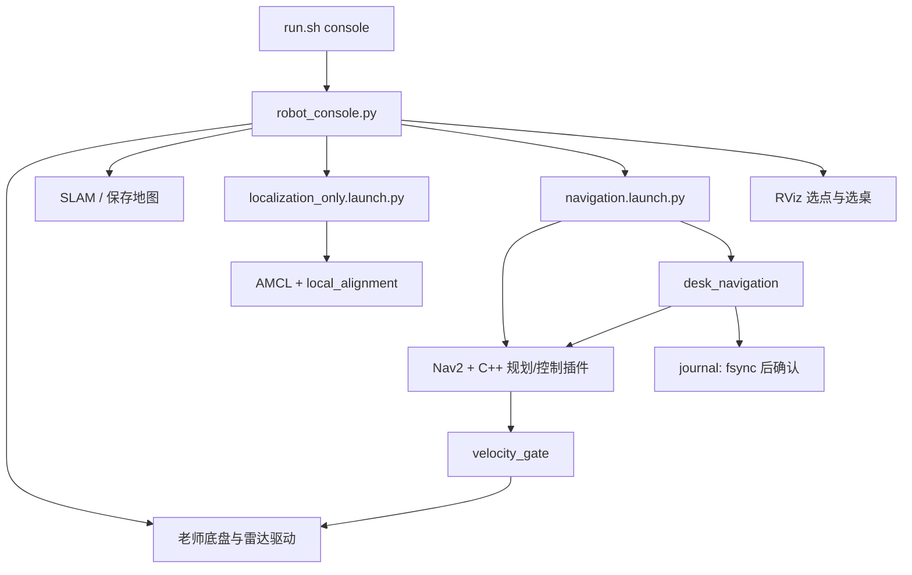

# 导航代码结构与职责

## 实机启动链路

## 模块边界

| 位置 | 职责 |
|---|---|
| `scripts/robot_console.py` | 单一交互主程序；按键、模式、任务生命周期、健康门控和 RViz 目标桥接 |
| `scripts/keyboard_bindings.py` | 老师按键表；不创建 ROS 节点、不发布速度 |
| `scripts/process_control.py` | 停止由主程序创建的进程组 |
| `scripts/map_catalog.py` / `map_ui.py` | 场景发现、配置切换、桌子选择及标记清理 |
| `ic382_navigation/runtime_config.py` | 配置解析、激光相对车体外廓、桌边候选点几何 |
| `ic382_navigation/inspection.py` | 桌号和候选点校验、按当前位姿选择下一点；旧成本排序函数仅供诊断测试 |
| `ic382_navigation/desk_navigation.py` | 每桌三个不同点的状态机、C 确认、停稳、健康检查 |
| `ic382_navigation/navigation.py` | 单个 NavigateToPose 动作的提交、反馈、取消和结束状态 |
| `ic382_navigation/events.py` / `journal_node.py` | 事件序号、待确认计时、落盘和 ACK |
| `ic382_navigation/local_alignment.py` | 手动初始定位后的 1 Hz 雷达修正节点、时间同步和单实例保护 |
| `ic382_navigation/local_scan_match.py` | 局部匹配与位姿运动补偿的计算逻辑 |
| `ic382_navigation/velocity_gate.py` / `core.py` | 最终速度输出权限、限速和传感器/命令看门狗 |
| `ic382_navigation/teacher_profile.py` | 老师基础参数与差速车当前策略的集中组合 |
| `ic382_planners/src/clearance_lattice.cpp` | 测量车体路径检查、10 cm 可让步的规划偏好 |
| `ic382_planners/src/staged_goal_controller.cpp` | 先到位置、再原地调整最终朝向 |
| `behavior_trees/retreat_and_replan.xml` | 当前段失败后的有限后退与重规划 |

## 保留的行为与验证位置

| 行为 | 验证 |
|---|---|
| 手动移动、0.5 秒输入超时、空格停车、限速、退出恢复终端 | `check_keyboard.py` |
| 单路 RViz 目标桥接、健康不满足时停止 | `check_point_navigation.py` |
| 地图和标定绑定、未标定地图清空旧标记 | `check_map_catalog.py`、`check_marker_isolation.py` |
| IMU 保留、局部搜索半径 12 cm/±6°、单步 6 cm/4°、同步补偿 | `test_local_scan_match.py`、`check_local_alignment.py` |
| 每次只导航当前点，C 后读取最新位姿 | `check-desk-api.py` |
| 空闲等待不算日志超时，新事件未确认超过 5 秒仍失败 | `test_events_ack.py`、`check-desk-api.py` |
| 雷达前 10/后 30/左右 20 cm 车体；检查点距离 40 cm | `test_runtime_config.py`、`test_differential_drive_profile.py` |
| 10 cm 是可让步的规划偏好，行驶碰撞检查仍使用真实车体 | `check_body_clearance_planner.py`、`check_controller_collision.py` |
| 到点 0.1 m 容差后锁定平移；原地旋转按现有操作员策略不做扫掠预测 | `check_inplace_controller.py` |
| 后退成功后重新规划，恢复次数有限 | `check_retreat_recovery.py` |

运行配置中的地图路径、桌子多边形和场景配置属于用户数据；不能以本地空配置模板覆盖实机文件。`simulation_*` 模块只为仿真提供输入适配，老师与上游源码保留来源和许可证。
